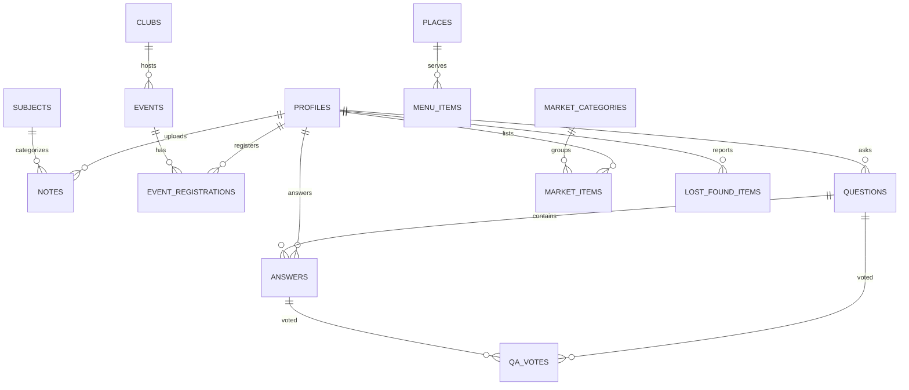

# BMSCE Hub — Database Schema & Entity Relationships

This document outlines the complete relational database architecture planned for **BMSCE Hub** on PostgreSQL / Supabase, covering all seven core campus features.

---

## 1. Entity Relationship Overview

---

## 2. Table Specifications by Feature

### Core: Student Profiles & Authentication
- **Table: `public.profiles`**
  - `id`: UUID (Primary Key, references `auth.users(id)` ON DELETE CASCADE)
  - `usn`: VARCHAR(10) UNIQUE NOT NULL (e.g., `1BM22CS089`)
  - `full_name`: TEXT NOT NULL
  - `email`: TEXT UNIQUE NOT NULL (restricted to `@bmsce.ac.in` domain)
  - `branch`: TEXT NOT NULL (Enum: `CSE`, `ISE`, `AIML`, `ECE`, `EEE`, `ME`, `CV`, etc.)
  - `semester`: SMALLINT NOT NULL (1 to 8)
  - `role`: TEXT DEFAULT 'student' (`student`, `club_lead`, `faculty`, `admin`)
  - `avatar_url`: TEXT
  - `created_at`: TIMESTAMPTZ DEFAULT NOW()
  - `updated_at`: TIMESTAMPTZ DEFAULT NOW()

---

### Feature 1: Student Dashboard & Notifications
- **Table: `public.notifications`**
  - `id`: UUID PRIMARY KEY DEFAULT gen_random_uuid()
  - `user_id`: UUID REFERENCES public.profiles(id) ON DELETE CASCADE
  - `title`: TEXT NOT NULL
  - `message`: TEXT NOT NULL
  - `type`: TEXT NOT NULL (`academic`, `event`, `qa`, `marketplace`, `lost_found`)
  - `link`: TEXT
  - `is_read`: BOOLEAN DEFAULT FALSE
  - `created_at`: TIMESTAMPTZ DEFAULT NOW()

---

### Feature 2: Notes & Study Resources
- **Table: `public.subjects`**
  - `id`: UUID PRIMARY KEY DEFAULT gen_random_uuid()
  - `code`: VARCHAR(10) UNIQUE NOT NULL (e.g., `21CS52`)
  - `title`: TEXT NOT NULL
  - `branch`: TEXT NOT NULL
  - `semester`: SMALLINT NOT NULL
  - `scheme`: TEXT DEFAULT '2022 Scheme'

- **Table: `public.notes`**
  - `id`: UUID PRIMARY KEY DEFAULT gen_random_uuid()
  - `subject_id`: UUID REFERENCES public.subjects(id) ON DELETE RESTRICT
  - `uploader_id`: UUID REFERENCES public.profiles(id) ON DELETE SET NULL
  - `title`: TEXT NOT NULL
  - `description`: TEXT
  - `semester`: SMALLINT NOT NULL
  - `branch`: TEXT NOT NULL
  - `module_no`: TEXT NOT NULL (`1`, `2`, `3`, `4`, `5`, `Full Syllabus`, `PYQs`)
  - `file_url`: TEXT NOT NULL (Stored in Supabase Storage bucket `bmsce-notes`)
  - `file_size`: TEXT NOT NULL
  - `file_type`: TEXT NOT NULL (`pdf`, `zip`)
  - `downloads_count`: INTEGER DEFAULT 0
  - `upvotes_count`: INTEGER DEFAULT 0
  - `status`: TEXT DEFAULT 'approved' (`pending`, `approved`, `flagged`)
  - `created_at`: TIMESTAMPTZ DEFAULT NOW()

- **Table: `public.note_upvotes`**
  - `id`: UUID PRIMARY KEY DEFAULT gen_random_uuid()
  - `note_id`: UUID REFERENCES public.notes(id) ON DELETE CASCADE
  - `user_id`: UUID REFERENCES public.profiles(id) ON DELETE CASCADE
  - UNIQUE(`note_id`, `user_id`)

---

### Feature 3: Events & Clubs with Registration
- **Table: `public.clubs`**
  - `id`: UUID PRIMARY KEY DEFAULT gen_random_uuid()
  - `name`: TEXT NOT NULL (e.g., `CodeRIT`, `Bullz Racing`, `Rotaract BMSCE`)
  - `slug`: TEXT UNIQUE NOT NULL
  - `category`: TEXT NOT NULL (`Technical`, `Cultural`, `Sports`, `Social`, `Motorsports`)
  - `description`: TEXT
  - `logo_url`: TEXT
  - `coordinator_name`: TEXT NOT NULL
  - `contact_email`: TEXT NOT NULL
  - `created_at`: TIMESTAMPTZ DEFAULT NOW()

- **Table: `public.events`**
  - `id`: UUID PRIMARY KEY DEFAULT gen_random_uuid()
  - `club_id`: UUID REFERENCES public.clubs(id) ON DELETE CASCADE
  - `title`: TEXT NOT NULL
  - `slug`: TEXT UNIQUE NOT NULL
  - `description`: TEXT NOT NULL
  - `venue`: TEXT NOT NULL (e.g., `BSN Auditorium`, `Mech Seminar Hall`)
  - `date_time`: TIMESTAMPTZ NOT NULL
  - `registration_deadline`: TIMESTAMPTZ NOT NULL
  - `category`: TEXT NOT NULL (`Hackathon`, `Workshop`, `Cultural`, `Social`, `Competitions`)
  - `max_seats`: INTEGER NOT NULL DEFAULT 100
  - `registered_count`: INTEGER DEFAULT 0
  - `fee`: NUMERIC(10,2) DEFAULT 0
  - `created_at`: TIMESTAMPTZ DEFAULT NOW()

- **Table: `public.event_registrations`**
  - `id`: UUID PRIMARY KEY DEFAULT gen_random_uuid()
  - `event_id`: UUID REFERENCES public.events(id) ON DELETE CASCADE
  - `user_id`: UUID REFERENCES public.profiles(id) ON DELETE CASCADE
  - `status`: TEXT DEFAULT 'registered' (`registered`, `attended`, `cancelled`)
  - `ticket_qr_code`: TEXT
  - `created_at`: TIMESTAMPTZ DEFAULT NOW()
  - UNIQUE(`event_id`, `user_id`)

---

### Feature 4: Canteen and Nearby Places
- **Table: `public.places`**
  - `id`: UUID PRIMARY KEY DEFAULT gen_random_uuid()
  - `name`: TEXT NOT NULL (e.g., `BMSCE Main Campus Canteen`, `Nescafe Lawns`, `Vidyarthi Bhavan`)
  - `slug`: TEXT UNIQUE NOT NULL
  - `category`: TEXT NOT NULL (`On-Campus Canteen`, `Campus Kiosk`, `Nearby Legend`, `Quick Bites`)
  - `timing`: TEXT NOT NULL
  - `location`: TEXT NOT NULL
  - `distance_walk`: TEXT NOT NULL
  - `rating`: NUMERIC(2,1) DEFAULT 4.0
  - `is_open`: BOOLEAN DEFAULT TRUE
  - `price_range`: TEXT DEFAULT '₹'
  - `image_url`: TEXT
  - `crowd_level`: TEXT DEFAULT 'Moderate' (`Low`, `Moderate`, `Busy`, `Peak Lunch Rush`)
  - `created_at`: TIMESTAMPTZ DEFAULT NOW()

- **Table: `public.menu_items`**
  - `id`: UUID PRIMARY KEY DEFAULT gen_random_uuid()
  - `place_id`: UUID REFERENCES public.places(id) ON DELETE CASCADE
  - `name`: TEXT NOT NULL
  - `price`: NUMERIC(10,2) NOT NULL
  - `category`: TEXT (`Breakfast`, `Meals`, `Snacks`, `Beverages`)
  - `is_veg`: BOOLEAN DEFAULT TRUE
  - `is_available`: BOOLEAN DEFAULT TRUE

---

### Feature 5: Ask a Senior Q&A Board
- **Table: `public.questions`**
  - `id`: UUID PRIMARY KEY DEFAULT gen_random_uuid()
  - `author_id`: UUID REFERENCES public.profiles(id) ON DELETE CASCADE
  - `title`: TEXT NOT NULL
  - `content`: TEXT NOT NULL
  - `tags`: TEXT[] NOT NULL
  - `upvotes_count`: INTEGER DEFAULT 0
  - `answers_count`: INTEGER DEFAULT 0
  - `is_resolved`: BOOLEAN DEFAULT FALSE
  - `created_at`: TIMESTAMPTZ DEFAULT NOW()
  - `updated_at`: TIMESTAMPTZ DEFAULT NOW()

- **Table: `public.answers`**
  - `id`: UUID PRIMARY KEY DEFAULT gen_random_uuid()
  - `question_id`: UUID REFERENCES public.questions(id) ON DELETE CASCADE
  - `author_id`: UUID REFERENCES public.profiles(id) ON DELETE CASCADE
  - `content`: TEXT NOT NULL
  - `upvotes_count`: INTEGER DEFAULT 0
  - `is_accepted`: BOOLEAN DEFAULT FALSE
  - `is_senior_verified`: BOOLEAN DEFAULT FALSE
  - `created_at`: TIMESTAMPTZ DEFAULT NOW()

- **Table: `public.qa_votes`**
  - `id`: UUID PRIMARY KEY DEFAULT gen_random_uuid()
  - `user_id`: UUID REFERENCES public.profiles(id) ON DELETE CASCADE
  - `item_type`: TEXT NOT NULL (`question`, `answer`)
  - `item_id`: UUID NOT NULL
  - `vote_type`: SMALLINT NOT NULL (1 or -1)
  - UNIQUE(`user_id`, `item_type`, `item_id`)

---

### Feature 6: Student Marketplace
- **Table: `public.market_categories`**
  - `id`: UUID PRIMARY KEY DEFAULT gen_random_uuid()
  - `name`: TEXT UNIQUE NOT NULL

- **Table: `public.market_items`**
  - `id`: UUID PRIMARY KEY DEFAULT gen_random_uuid()
  - `seller_id`: UUID REFERENCES public.profiles(id) ON DELETE CASCADE
  - `title`: TEXT NOT NULL
  - `description`: TEXT NOT NULL
  - `price`: NUMERIC(10,2) NOT NULL
  - `original_price`: NUMERIC(10,2)
  - `condition`: TEXT NOT NULL (`Brand New`, `Like New`, `Good Condition`, `Usable`)
  - `category`: TEXT NOT NULL
  - `preferred_location`: TEXT NOT NULL (e.g. `Library lawns`, `Mechanical Block`)
  - `contact_phone`: TEXT
  - `image_urls`: TEXT[]
  - `status`: TEXT DEFAULT 'Available' (`Available`, `Reserved`, `Sold`)
  - `created_at`: TIMESTAMPTZ DEFAULT NOW()
  - `updated_at`: TIMESTAMPTZ DEFAULT NOW()

---

### Feature 7: Lost and Found
- **Table: `public.lost_found_items`**
  - `id`: UUID PRIMARY KEY DEFAULT gen_random_uuid()
  - `reporter_id`: UUID REFERENCES public.profiles(id) ON DELETE CASCADE
  - `type`: TEXT NOT NULL (`Lost`, `Found`)
  - `title`: TEXT NOT NULL
  - `description`: TEXT NOT NULL
  - `category`: TEXT NOT NULL (`ID Cards & Wallets`, `Calculators & Electronics`, `Keys`, `Bottles & Bags`, `Books`)
  - `location`: TEXT NOT NULL (e.g. `Central Library 2nd Floor`, `Mech Seminar Hall`)
  - `date_reported`: TIMESTAMPTZ DEFAULT NOW()
  - `contact_info`: TEXT NOT NULL
  - `status`: TEXT DEFAULT 'Open' (`Open`, `Claimed`, `Resolved`)
  - `image_url`: TEXT
  - `created_at`: TIMESTAMPTZ DEFAULT NOW()
